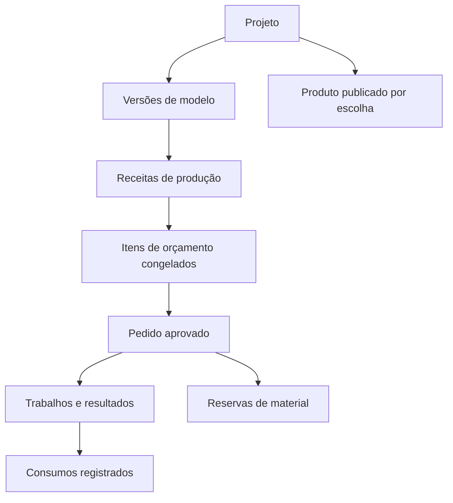

# Domínio, dados e integridade

## 1. Convenções

- IDs internos estáveis. Nome, telefone, slug e nome de arquivo não são chaves de relacionamento.
- Registro mutável recebe `createdAt`, `updatedAt`, `revision` e arquivamento quando aplicável.
- Dinheiro interno: decimal de alta precisão. Valores comerciais finais: centavos inteiros ou decimal de duas casas.
- Massas em gramas decimais; duração em segundos inteiros; quantidades de componentes/produtos inteiras positivas.
- Datas comerciais sem horário são datas locais. Instantes são guardados em UTC e exibidos em `America/Sao_Paulo`.
- Configurações e documentos históricos guardam as unidades utilizadas. Não depender do formato visual da célula de origem.
- Um workspace privado por conta cadastrada, com proprietário explícito. `workspaceId` e propriedade devem ser validados no servidor em toda operação privada; o cliente não pode escolher arbitrariamente o workspace de outra pessoa.

## 2. Entidades

| Entidade | Campos e responsabilidade essenciais |
| --- | --- |
| WorkspaceSettings | Nome comercial, timezone, contato, identidade, parâmetros padrão e política de cálculo |
| User/Session | Conta por e-mail/senha, verificação, recuperação e sessão; propriedade de workspace; não usar o cadastro de cliente como login |
| Client | Nome, telefone, e-mail e observações opcionais; arquivamento |
| Project | Nome, descrição, cliente opcional, etiquetas, estado ativo/arquivado |
| ModelVersion | Projeto, número da versão, arquivos, origem declarada, observações, aprovação |
| Asset | Chave de armazenamento, tipo, tamanho, hash, papel, acesso e metadados; nunca conteúdo base64 em tabelas de negócio |
| Material | Tipo, fabricante, descrição, cor e código interno opcional |
| MaterialPrice | Material, custo por grama, data e origem; histórico de referência |
| MachineProfile | P2S, parâmetros de custo, manutenção, vida útil e versão |
| ProductionRecipeVersion | Projeto/modelo, versão, componentes necessários, placas e operações manuais |
| Component | Identificador e nome da parte física; quantidade por produto completo na receita |
| PlateDefinition | Receita, duração, materiais, saídas por componente e preparação de máquina |
| PlateMaterialUsage | Placa, material, gramas, finalidade opcional: peça/suporte/purga |
| PlateOutput | Placa e quantidade de cada componente produzido por execução |
| LaborOperation | Descrição, duração ativa, taxa por hora e incidência: por pedido, execução ou produto |
| AdditionalCostPreset | Cadastro reutilizável de custo adicional, valor-base e incidência; privado por workspace; não gera cobrança por si só |
| ExtraCost | Descrição, valor e incidência: por pedido, execução, produto ou quantidade explícita |
| Quote/QuoteRevision | Identificação comercial e revisão com itens, condições, validade e conteúdo congelado |
| QuoteItemSnapshot | Quantidade, receita, parâmetros, execução planejada, memória de cálculo e preço comercial |
| QuoteArtifact | PDF, hash, template e revisão emitida; reproduzir histórico sem depender do template atual |
| Order/OrderItem | Revisão aprovada, quantidades, prazo e cópia do compromisso comercial |
| PrintJob | Uma execução planejada ou reimpressão de placa; receita congelada e vínculo com pedido |
| JobResult | Componentes aprovados/rejeitados, duração, consumo real e observações |
| Spool | Material, aquisição, massa utilizável, saldo calculado e localização |
| StockMovement | Entrada, consumo, ajuste, estorno; gramas assinadas, custo, motivo e referência |
| StockReservation | Pedido/trabalho, rolo, quantidade pendente e estado |
| ScheduleEntry | Máquina, trabalho, início/fim e versão para detectar conflitos |
| AvailabilityRule/Block | Janelas recorrentes de máquina, disponibilidade humana e bloqueios datados |
| PaymentEntry | Pedido, valor, data, tipo recebimento/estorno e referência opcional |
| ProductListing | Conteúdo comercial selecionado, slug, fotos públicas e estado de publicação |
| BrandKit/ContentDraft | Ativos visuais, templates, legendas e arquivos exportados |
| AuditEvent | Mudanças materiais, autor, data, ação e IDs envolvidos; sem duplicar arquivos/segredos |

Criar entidades quando o marco exigir. A tabela é o modelo-alvo, não autorização para construir todas as interfaces em M0.

## 3. Relações fundamentais

Fotos podem ser associadas a vários contextos por referências. Um ativo privado não se torna público só porque está associado a um produto publicado; a publicação seleciona uma versão comercial explicitamente autorizada.

## 4. Composição e rendimento

Uma receita descreve a quantidade de cada componente necessária para **um produto completo**. Exemplo: troféu = uma base + um corpo + duas letras.

Cada placa informa quantos componentes produz em uma execução. Em R1/R2, cada componente tem exatamente uma placa fornecedora ativa dentro da receita. Se duas alternativas fabricam a mesma parte, são receitas alternativas, não duas fontes concorrentes no mesmo plano.

Uma placa pode produzir vários componentes do mesmo produto. A quantidade de execuções é suficiente para atender à maior necessidade relativa dos componentes dessa placa. As sobras devem aparecer no plano; não podem desaparecer do custo.

Os trabalhos de impressão produzem componentes. Produtos completos disponíveis = menor razão inteira entre componentes aprovados e quantidades exigidas. Isso não conclui automaticamente montagem ou acabamento.

## 5. Versionamento

1. Editar configuração em rascunho é permitido.
2. Configuração usada em revisão emitida torna-se imutável; alterações criam uma versão nova.
3. Emissão congela nomes comerciais, cliente apresentado, receita, custos, fórmulas, parâmetros, preços, imagens selecionadas e condições.
4. Estado de envio/aprovação pode mudar sem alterar o conteúdo congelado.
5. Nova revisão não sobrescreve PDFs anteriores. A revisão substituída continua consultável.
6. Pedido usa a revisão aprovada, inclusive se o produto ou o preço do material mudar depois.
7. Revisão nova após aprovação não altera o pedido. Alterações comerciais após aprovação exigem revisão de pedido explícita, fora do fluxo automático inicial.

Duplicar orçamento deve perguntar se os preços serão preservados ou atualizados. Sempre mostrar a origem dos dados usados.

O artefato PDF tem estado próprio `pending`, `ready` ou `failed`. Se a geração falhar após congelar a revisão, tentar novamente o mesmo snapshot com a mesma identificação, sem duplicar a emissão. Não apresentar download pronto nem registrar envio enquanto o artefato necessário estiver indisponível.

## 6. Estados

### Orçamento

`draft` → `issued` → `sent` → `approved` ou `declined`.

Revisões emitidas/enviadas podem ficar `expired` ou `superseded`. Aprovação expirada exige ação explícita de revalidação ou nova revisão; não converter silenciosamente. A emissão é a trava de conteúdo. Envio é apenas registro manual.

### Pedido

`awaiting_planning` → `scheduled` → `in_production` → `finishing` → `ready` → `delivered`.

Pedido pode receber `cancelled` com motivo. Pendência de material é um indicador independente, pois não deve substituir o estado produtivo. Entregar parcialmente exige entregas com quantidades registradas; a interface pode introduzi-las em M5. `delivered` exige todas as unidades contratadas entregues ou encerramento parcial explicitamente acordado.

### Trabalho

`planned` → `running` → `completed` ou `failed`. Antes do início, pode ser `cancelled`.

Resultado parcialmente aprovado é válido em `completed` e deve informar rejeições. Uma falha pode ter componentes aprovados; registrar o resultado físico, sem assumir zero. Não permitir contagem aprovada + rejeitada acima da saída prevista sem ajuste explícito de plano.

## 7. Transações e idempotência

- Uma revisão aprovada pode originar somente um pedido: índice único e operação idempotente.
- Conclusão de um trabalho não pode baixar o mesmo consumo duas vezes. Use chave idempotente e transação.
- Baixar material e liberar sua reserva correspondente acontecem juntos.
- Reserva não pode deixar disponibilidade negativa. Concorrência deve ser resolvida no banco, não apenas no estado da tela.
- Programação de duas requisições simultâneas para o mesmo intervalo não pode produzir sobreposição.
- Movimentação de estoque confirmada não é editada/apagada; correção cria estorno ligado ao movimento e novo registro.
- Recebimento confirmado também é corrigido por estorno, preservando o histórico.
- Operações rejeitadas por versão desatualizada devolvem conflito e oferecem recarregar sem perder rascunho.

## 8. Estoque e valorização

Em R2, custo registrado de material é específico do rolo consumido: custo de aquisição dividido pela massa utilizável adquirida. Não implementar média móvel, FIFO ou gestão fiscal como requisito.

Saldo físico é soma de movimentos. Reserva não altera saldo. Consumo cria movimento negativo e reduz reserva remanescente. Se outro rolo for utilizado, exigir troca explícita da alocação.

Um trabalho pode consumir vários rolos de um mesmo material. Ajuste por pesagem requer motivo. Peso do carretel vazio pode ser informado para ajudar na pesagem, mas não é obrigatório para cadastro manual do saldo utilizável.

Material remanescente não consumido é liberado ao encerrar/cancelar o trabalho. Material consumido numa falha continua nos custos. Componentes aprovados excedentes ficam registrados; reaproveitamento entre pedidos é evolução, sem crédito automático de custos em R2.

Se o consumo informado superar a reserva, verificar o saldo físico disponível e ajustar a alocação explicitamente. Se o saldo registrado for insuficiente, permitir corrigir por pesagem/entrada com motivo antes da baixa; não criar saldo negativo silencioso nem descartar a informação do resultado físico.

## 9. Arquivamento e exclusão

Arquivar clientes/projetos/materiais referenciados; não apagar registros que sustentam documentos. Excluir rascunhos sem vínculos pode ser permitido com confirmação. Arquivos usados em documento emitido precisam de retenção; renomear o upload não pode quebrar as referências.

Exclusões de dados pessoais e política de retenção devem ser tratadas separadamente antes de operação pública em escala. Para este escopo, coletar apenas dados necessários e permitir exportação.

## 10. Índices e invariantes mínimos

Índices para workspace + nome/busca, cliente, status, projeto e datas. Unicidade de número/revisão de orçamento, versão por receita, pedido por revisão aprovada e chave idempotente por operação. Quantidades/custos não negativos conforme tipo; duração de impressão maior que zero; custo zero explícito é diferente de custo ausente.

Garantir por serviço transacional as regras entre tabelas que não cabem em uma única constraint. `workspaceId` deve ser validado em toda leitura e mutação privada, inclusive download de arquivos e geração de PDF.
